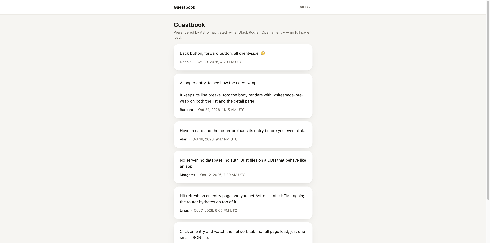

# astro-tanstack-router

A static-site starter: **Astro** prerenders every page at build time, and **TanStack Router** takes over in the browser for client-side navigation, with **TanStack Query** holding the data on both sides. It's the static sibling of [astro-tanstack-kysely-starter](https://github.com/sookmax/astro-tanstack-kysely-starter): the same router bridge and the same guestbook look, but with no server, database, auth or mutations at runtime. `dist/` is plain files for any static host.



[Live demo](https://astro-tanstack-router.vercel.app/)

The demo app is a read-only **guestbook** with two pages:

- `/`: the list of entries
- `/entries/:id`: one entry

Load either page directly and you get Astro's prerendered HTML, which the router then hydrates. Click between them and nothing reloads—client-side navigations. The router runs the next route's `beforeLoad`, TanStack Query fetches a small JSON file that Astro also generated at build time, and the new page renders in place. Hovering a card preloads its JSON before the click.

## Stack

|             |                                                                                       |
| ----------- | ------------------------------------------------------------------------------------- |
| Rendering   | Astro 7 (`output: "static"`) + React 19                                               |
| Routing     | TanStack Router (file-based, prerendered through a hand-rolled Astro bridge)          |
| Data        | TanStack Query 5, the `query()` API, filled at build time and hydrated in the browser |
| Data source | A TS seed (`src/data/entries.ts`) plus static JSON endpoints generated from it        |
| Validation  | Zod 4                                                                                 |
| Styling     | Tailwind CSS 4 with `light-dark()` semantic tokens                                    |
| Tooling     | oxlint (type-aware), `astro check`, Prettier, Storybook 10                            |

## Getting started

Requires Node 24 and pnpm.

```bash
pnpm install    # also points git at .githooks (see below)
pnpm dev        # http://localhost:4321
```

> **Heads-up: `pnpm install` changes your git config for this repo.** The `prepare` script runs `git config core.hooksPath .githooks`, which writes to this clone's `.git/config` (not your global config). From then on, git runs only the hooks in `.githooks/`: currently a pre-commit hook that runs `pnpm lint`. Skip it once with `git commit --no-verify`; opt out entirely with `git config --unset core.hooksPath`.

## Commands

```bash
pnpm dev                 # dev server
pnpm build               # prerender everything into dist/
pnpm preview             # serve dist/ the way a static host would

pnpm lint                # oxlint (TS/React, type-aware) + astro check (.astro files)
pnpm format              # Prettier
pnpm storybook           # http://localhost:6006
pnpm build-storybook     # static Storybook in storybook-static/
pnpm generate-routes     # regenerate src/react/routeTree.gen.ts (dev/build do this too)
```

## Layout

```
src/
  data/entries.ts        the seed — the only data source (server-only)
  pages/
    index.astro          /             ┐ fill the query cache from the seed at build time,
    entries/[id].astro   /entries/:id  ┘ then render ReactServerEntry (getStaticPaths → one file per entry)
    api/entries.json.ts          → dist/api/entries.json     ┐ what the client fetches
    api/entries/[id].json.ts     → dist/api/entries/<id>.json ┘ on navigation
    404.astro            static 404 (no router)
  components/            ReactServerEntry.astro: the prerender half of the router bridge
  layouts/               Layout.astro
  react/                 router.tsx, ReactClientEntry.tsx, routes/, components/, hooks/
  lib/
    query-common.ts      query keys + QueryClient defaults (shared)
    query-server.ts      server options: queryFn reads the seed        ┐ same keys
    query-client.ts      client options: queryFn fetches the JSON      ┘
    queries/             server-only seed readers
    fetch/               client fetch wrappers
    schemas/             client-safe Zod schemas + types
    apiPaths.ts          the JSON endpoints' URLs
  utils/
.storybook/              Storybook (@storybook/tanstack-react)
```

## How it works

### One cache, two ways in

```
DIRECT HIT (prerendered HTML)                     CLIENT NAVIGATION (a <Link> click)
─────────────────────────────                     ──────────────────────────────────
src/pages/entries/[id].astro, at build time       route beforeLoad (src/react/routes/entries/$id.tsx)
  queryClient.query(getEntryOptions(id))            queryClient.query(fetchEntryOptions(id))
    queryFn → the seed          ← query-server        queryFn → fetch /api/entries/<id>.json ← query-client
        │                                                 │
        ▼                                                 ▼
ReactServerEntry.astro                             cache filled under ["entries","detail",id]
  renders the router to a string,
  ships the dehydrated cache as JS (devalue uneval)
        │
        ▼
ReactClientEntry (client:only) hydrates it
  → route beforeLoad runs the CLIENT options,
    finds the key already cached → no request
```

`query-server.ts` and `query-client.ts` build their options from the same keys (`query-common.ts`). The prerendered page fills the cache with a seed-backed `queryFn`, so the browser's `fetch` `queryFn` never runs for the page you landed on. It runs only when you navigate somewhere whose data isn't cached yet. The data changes only with a new build, so the QueryClient uses `staleTime: "static"`: once an entry is cached, it stays cached for the visit.

The seed lives in `src/data/entries.ts` and is read only through `src/lib/queries/*`, which start with `import "@/utils/server-module"`. If one of them ever leaks into the client bundle, it throws instead of quietly shipping the data in the JS.

### Why static JSON endpoints

A client-side navigation needs the next page's data, and there's no server to ask. Astro can prerender endpoints as well as pages, so `src/pages/api/*.json.ts` turn the seed into `dist/api/entries.json` and one `dist/api/entries/<id>.json` per entry, using the same `getStaticPaths` list as the HTML pages. The client then fetches a JSON file that is the same size as the data it needs. Bundling the seed into the client JS would also work, but it would send every entry to every visitor and grow with the data. An unknown id has no JSON file, so the host's 404 becomes `EntryNotFoundError`, which the router's `ErrorFallback` renders.

### The Astro ↔ TanStack Router bridge

- `ReactServerEntry.astro` renders `<RouterServer>` with `renderToString`. It then gets the router's hydration scripts (`$_TSR`, the dehydrated matches) from `transformReadableStreamWithRouter`, fed an **empty, closed** stream. Our fragment has no `<Scripts />` boundary, so router-core appends those scripts after the app stream, and the output is exactly the HTML to inject. (Older routers exposed this as `serverSsr.takeBufferedHtml()`.) While prerendering, `Astro.request` is a synthetic request for the page's own path, which is all the router needs.
- The router context carries the live `queryClient` (never serialized) and `dehydratedQueryState`. Only `dehydratedQueryState` is written into the page, as `window.__ROUTER_CONTEXT__` via devalue's `uneval`, so `Date`s survive as `new Date(...)`. `define:vars` isn't used because it would JSON-stringify them.
- `createRouter()` (`src/react/router.tsx`) runs on both sides. On the server it dehydrates the page's filled cache. On the client it hydrates that state into a fresh QueryClient.
- A loading overlay ships in the first paint, and `__root`'s effect removes it once the page is hydrated.
- The router plugin code-splits route components **for the client environment only** (`environmentName: "client"` in `tsr.vite.plugin.ts`). Vite's SSR module runner also has `import.meta.hot`, and the plugin's dev HMR code would keep the server rendering stale components after an edit, causing hydration mismatches.
- Astro owns `<head>`, so `<title>` is prerendered by the `.astro` page and kept in sync on client navigation by `useDocumentTitle`. Both use `pageTitle()`.

## Storybook

`pnpm storybook` runs Storybook with `@storybook/tanstack-react`, which wraps every story in a router so `<Link>` works. Stories live next to their components in `src/react/components/*.stories.tsx` (EntryCard, EntryList, ErrorView). Those components are presentational: data comes in as props and the routes own the queries, so stories need no QueryClient. Storybook runs its own Vite from the root `vite.config.ts` (Tailwind, the `@/*` alias, the router plugin), not from `astro.config.mjs`. The toolbar's colour-scheme switch flips `data-theme` on the root.

## Lint and type checking

- `oxlint` lints TS/React with type-aware rules **and** reports type errors (`typeCheck: true`), using oxlint-tsgolint's bundled TypeScript 7.
- `astro check` covers `.astro` files, on the `typescript` 6.x devDependency.
- One `tsconfig.json` serves both. Keep it free of TS 6 deprecations, which TS 7 removed.
